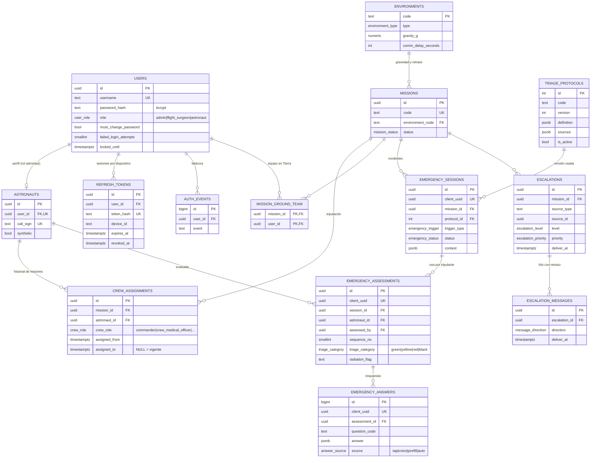

# API · Identidad, tripulación y modo emergencia (v1)

Base: `/api/v1` · JSON · fechas ISO 8601 en UTC · errores: `{ "error": { "code", "message", "details" } }`
Autenticación: `Authorization: Bearer <access_token>` salvo en login y refresh.

> Datos de demo sintéticos. La app es apoyo a la decisión, no un diagnóstico médico.

## Diagrama ER



Restricciones clave (probadas):
- Un astronauta no puede tener dos asignaciones solapadas (`EXCLUDE` con `tstzrange`), pero sí un historial de misiones.
- Un solo comandante y un solo oficial médico (CMO) vigentes por misión.
- Solo usuarios con rol `astronaut` tienen perfil de astronauta, y un astronauta no puede estar en el equipo de Tierra (triggers).
- `password_hash` debe tener formato bcrypt (`CHECK`).
- Una sola sesión de emergencia activa por misión.
- Una evaluación `completed` exige categoría de triaje.

---

## 1. Autenticación

### `POST /auth/login`
```json
{ "username": "a.ortega", "password": "Demo2026!", "device_id": "ipad-crew-01" }
```
**200**
```json
{
  "access_token": "eyJ...",
  "token_type": "Bearer",
  "expires_in": 3600,
  "refresh_token": "rt_8f2c...",
  "must_change_password": false,
  "offline_unlock_until": "2026-11-21T16:00:00Z",
  "user": { "id": "00000000-...-0011", "username": "a.ortega", "full_name": "Ana Ortega (sintética)", "role": "astronaut" },
  "context": {
    "astronaut_id": "10000000-...-0011",
    "call_sign": "ORION",
    "mission": { "id": "20000000-...-0001", "code": "ARES-1", "status": "active" },
    "environment": { "code": "mars_transit", "gravity_g": 0.0, "comm_delay_seconds": 90 },
    "crew_role": "commander"
  }
}
```
- Si `must_change_password = true`: se devuelve un `access_token` con `scope: "password_change"` que **solo** sirve para `POST /auth/change-password`. No se emite `refresh_token`.
- `context` sale de la asignación vigente (`v_current_crew`). Así el astronauta "queda asignado automáticamente": nunca elige misión.
- Errores: `401 INVALID_CREDENTIALS` (mismo mensaje si el usuario no existe: no se revela cuál falló) · `423 ACCOUNT_LOCKED` tras 5 intentos fallidos (bloqueo de 15 min, configurable) · `403 NO_ACTIVE_ASSIGNMENT` para un astronauta sin misión vigente.

### `POST /auth/change-password`
```json
{ "current_password": "Temp-4821-kx", "new_password": "Orion#Mars2026" }
```
**200** → misma forma que login (tokens completos). Política: mínimo 10 caracteres y distinta de la actual. `400 WEAK_PASSWORD` si no cumple.

### `POST /auth/refresh`
```json
{ "refresh_token": "rt_8f2c...", "device_id": "ipad-crew-01" }
```
**200** → `{ "access_token", "expires_in", "refresh_token" }`. Rotación: el token viejo se revoca (`replaced_by`). Si alguien reusa un token revocado, se revocan todos los del usuario y se registra `token_reuse_detected`.

### `POST /auth/logout` → **204** (revoca el refresh token del dispositivo)

### `GET /me` → **200** `{ "user": {...}, "context": {...} }` (igual que login)

---

## 2. Administración de tripulación (`admin`)

### `POST /admin/missions`
```json
{ "code": "ARES-2", "name": "Ares 2", "environment_code": "mars_base", "starts_at": "2026-12-01T00:00:00Z" }
```
**201** → `{ "id": "...", "code": "ARES-2", "status": "planned", ... }`

### `POST /admin/astronauts` — crea el usuario, el perfil y la asignación en una transacción
```json
{
  "username": "m.silva",
  "full_name": "Marco Silva",
  "call_sign": "ATLAS",
  "agency": "Demo Agency",
  "mission_id": "20000000-...-0001",
  "crew_role": "mission_specialist"
}
```
**201**
```json
{
  "astronaut": { "id": "...", "call_sign": "ATLAS", "synthetic": true },
  "user": { "id": "...", "username": "m.silva", "role": "astronaut", "must_change_password": true },
  "assignment": { "id": "...", "mission_code": "ARES-1", "crew_role": "mission_specialist" },
  "temporary_password": "Temp-4821-kx"
}
```
`temporary_password` se genera con `crypto.randomBytes`, **se muestra una sola vez** y solo se guarda su hash. Errores: `409 USERNAME_TAKEN` · `409 CREW_ROLE_TAKEN` (ya hay comandante o CMO) · `409 ASSIGNMENT_OVERLAP`.

### `POST /admin/users` — personal de Tierra
```json
{ "username": "dr.reyes", "full_name": "Elena Reyes", "role": "flight_surgeon", "mission_ids": ["20000000-...-0001"] }
```
**201** → `{ "user": {...}, "temporary_password": "..." }`

### `GET /admin/missions/:id/crew` → **200** `[{ "astronaut_id", "call_sign", "full_name", "crew_role", "assigned_from" }]`

### `PATCH /admin/assignments/:id` — termina una asignación (habilita reasignar a otra misión)
```json
{ "assigned_to": "2026-11-30T00:00:00Z" }
```

### `POST /admin/users/:id/reset-password` → **200** `{ "temporary_password": "..." }` (activa `must_change_password` y revoca sus refresh tokens)

---

## 3. Modo emergencia (cualquier tripulante de la misión)

Todos los `POST` llevan `client_uuid`: si la app los envía dos veces (reintento offline), el servidor responde **200** con el registro existente en vez de duplicarlo. Sin conexión, los mismos payloads viajan en `POST /sync/push` con `entity: "emergency_session" | "emergency_assessment" | "emergency_answer"` y `priority: "emergency"` (se sincronizan primero).

### `GET /emergency/protocol` → **200** protocolo activo (`code`, `version`, `definition`, `sources`). La app lo guarda en caché para funcionar offline.

### `POST /emergency/sessions`
```json
{
  "client_uuid": "b3a1...",
  "trigger_type": "manual_button",
  "started_at": "2026-11-14T08:02:00Z",
  "context": { "solar_event_active": true, "environment_alarm": null }
}
```
**201**
```json
{
  "session": { "id": "...", "status": "active", "protocol_version": 1 },
  "roster": [
    {
      "astronaut_id": "10000000-...-0013", "call_sign": "LYRA", "sequence_no": 1,
      "priority_reason": "Lectura crítica hace 12 min",
      "prefill": { "resp_rate_over_30": { "value": false, "source_reading_id": "...", "measured_at": "2026-11-14T07:55:00Z" } }
    },
    { "astronaut_id": "10000000-...-0011", "call_sign": "ORION", "sequence_no": 2, "priority_reason": null, "prefill": {} }
  ]
}
```
`409 SESSION_ALREADY_ACTIVE` devuelve la sesión activa para unirse a ella (dos tripulantes pueden evaluar en paralelo a personas distintas).

### `POST /emergency/sessions/:id/assessments`
```json
{ "client_uuid": "c7d2...", "astronaut_id": "10000000-...-0013", "sequence_no": 1, "is_self_assessment": false, "started_at": "2026-11-14T08:02:30Z" }
```

### `POST /emergency/assessments/:id/answers` — lote
```json
{
  "answers": [
    { "client_uuid": "e1...", "question_code": "responsive_and_mobile", "answer": { "value": false }, "source": "voice", "answered_at": "2026-11-14T08:02:41Z" },
    { "client_uuid": "e2...", "question_code": "breathing", "answer": { "value": true }, "source": "tap", "answered_at": "2026-11-14T08:02:49Z" },
    { "client_uuid": "e3...", "question_code": "resp_rate_over_30", "answer": { "value": false }, "source": "prefill", "source_reading_id": "...", "answered_at": "2026-11-14T08:02:50Z" }
  ]
}
```
**200** → `{ "accepted": 3, "duplicates": 0 }`

### `POST /emergency/assessments/:id/complete`
```json
{
  "completed_at": "2026-11-14T08:04:10Z",
  "device_result": { "triage_category": "red", "radiation_flag": "probable", "rules_version": 1 }
}
```
**200** — el servidor recalcula con el protocolo y su resultado manda
```json
{
  "triage_category": "red",
  "radiation_flag": "probable",
  "computed_by": "server",
  "matches_device": true,
  "escalations": [
    { "id": "...", "level": "crew", "priority": "emergency", "deliver_at": "2026-11-14T08:04:10Z" },
    { "id": "...", "level": "flight_surgeon", "priority": "emergency", "deliver_at": "2026-11-14T08:05:40Z" }
  ],
  "next": { "astronaut_id": "10000000-...-0011", "call_sign": "ORION", "sequence_no": 2 }
}
```

### `POST /emergency/sessions/:id/close`
```json
{ "closed_at": "2026-11-14T08:20:00Z", "status": "closed" }
```
**200** → resumen: conteo por categoría y escalamientos generados.

---

## 4. Panel: emergencias y bandeja (`flight_surgeon`, `admin`)

- `GET /admin/emergencies?mission_id=&status=active` → sesiones con sus evaluaciones y respuestas. **Solo las que ya "llegaron" a Tierra** (`deliver_at <= now()`).
- `GET /admin/escalations/inbox?mission_id=` → `v_ground_inbox` ordenada por prioridad y luego por `deliver_at`.
- `POST /admin/escalations/:id/ack` → **200** `{ "status": "acknowledged", "acknowledged_at": "..." }`
- `POST /admin/escalations/:id/messages`
  ```json
  { "body": "Recibido. Mantener a LYRA en el refugio y repetir signos vitales cada 15 min." }
  ```
  **201** → `{ "id": "...", "direction": "to_crew", "deliver_at": "2026-11-14T08:12:30Z" }` (llega a la app tras el retraso del entorno, vía `GET /sync/pull`).

---

## Fuentes del protocolo de triaje
- START Adult Triage Algorithm — HHS CHEMM: https://chemm.hhs.gov/startalgotext.htm
- START (pasos y criterios) — WikEM: https://www.wikem.org/wiki/Start_triage
- Pródromo de ARS y tiempo hasta el vómito — ORAU/REACTS: https://www.orau.gov/hsc/RadMassCasualties/assets/4_Triage_Handout.pdf
- ARS por eventos solares — NASA HRP Space Radiation Element: https://ntrs.nasa.gov/api/citations/20170001372/downloads/20170001372.pdf
- Risks of Human Spaceflight — NASA HRP: https://www.nasa.gov/hrp/risks/
